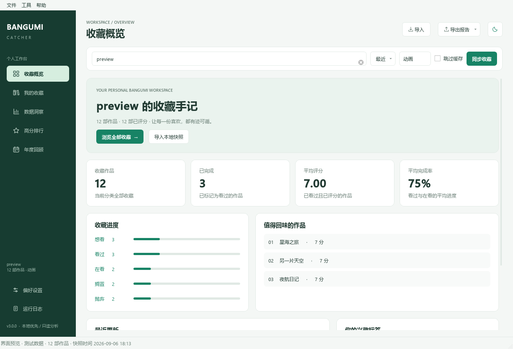

# Bangumi Catcher

**本地优先的 Bangumi 收藏工作台：同步、整理、回顾，让收藏不止于列表。**

PySide6 桌面应用 + 可脚本化 CLI，兼容 Python 3.9+。无需账号密码，不修改远程收藏。

[](https://github.com/Yun-me/Bangumi-Catcher/actions/workflows/ci.yml)
[](https://www.python.org/)
[](LICENSE)



## 4.0 带来了什么

4.0 是一次**结构性重构**，用户功能保持连续，开发体验彻底更新：

- **分层清晰的 `src` 布局**：`core` / `api` / `charts` / `reporting` / `services` /
  `ui` / `cli`，依赖方向由架构测试强制检查，不再出现 `services → ui` 的反向依赖。
- **为 agent 准备的仓库**：[AGENTS.md](AGENTS.md) 是唯一权威开发说明，配合
  [docs/](docs/README.md)、[playbooks](docs/playbooks/README.md)、[ADR](docs/adr/README.md)；
  `CLAUDE.md`、Cursor、Copilot 只保留短指针，避免规则漂移。
- **一条命令完成所有事**：`python scripts/dev.py check`（ruff + mypy + pytest），
  另有 `fmt/lint/type/test/cov/run/cli/build/package/smoke/clean`，跨平台且无第三方依赖。
- **离线测试体系**：注入 `httpx` transport 的 `FakeBangumiAPI`、录制夹具、全局网络守卫；
  400+ 个测试覆盖分页并发、取消清理、原子导出、Qt 生命周期、分层、文档与打包。
- **更可靠的网络层**：新增 `api.trust_env` 开关，规避异常 `NO_PROXY` 导致 httpx 初始化失败；
  `--verbose` / `--log-file` 与可配置日志。
- **CLI 增强**：新增 `config` 子命令，可直接查看合并后的有效配置（YAML/JSON）。

从 3.x 升级请阅读 [迁移说明](docs/migration-4.0.md)。

## 功能

- **收藏概览**：收藏/评分指标、状态分布、高分作品、最近更新、兴趣标签；点击即可继续筛选。
- **高效收藏库**：虚拟表格、160 ms 防抖搜索、状态/年份/评分组合筛选、数值排序、
  详情面板、右键菜单、筛选结果单独导出。
- **离线快照**：导入旧版/新版收藏 JSON，不联网即可查看与重新分析；报告 JSON 不会被误导入。
- **按需分析**：9 个图表维度在查看时才后台生成，按数据+主题缓存，可保存 PNG；
  启动和浏览收藏不加载 Matplotlib。
- **可靠后台任务**：抓取、分析、导入、导出都在工作线程；取消可中断在途 HTTP/重试；
  退出时等待任务安全结束，不强杀线程。
- **统一导出**：CSV、收藏 JSON、报告 JSON、自包含 HTML；GUI/CLI 共用原子实现，
  失败或取消不会覆盖旧文件。
- **只读与隐私**：不登录、不修改远程收藏、不绕过私有收藏限制；网络失败保留上一份数据。

更多界面见 [docs/assets/screenshots](docs/assets/screenshots)。

## 快速开始

```bash
git clone https://github.com/Yun-me/Bangumi-Catcher.git
cd Bangumi-Catcher
python -m pip install -e ".[dev]"
python -m bangumi_catcher
```

也可以 `python run.py`（会把 `src/` 加入模块路径）。Windows 上若 `python` 不在 PATH，
使用完整路径或 `py -3`。

### 第一次使用

1. 输入 **用户名 / 数字 UID / 用户主页链接**，例如 `https://bgm.tv/user/yourname`；
   显示昵称不是用户名。
2. 选择动画、书籍、音乐、游戏或三次元，点击「同步收藏」。
3. 从侧栏进入概览、收藏、洞察、排行、年度；用「作品详情」展开详情面板。
4. 「导出报告」导出完整数据；收藏页的「导出筛选结果」只导出当前匹配的行，保持排序。
5. 以后用「导入」打开收藏 JSON，即可离线回顾。

### 快捷键

| 按键 | 操作 |
|---|---|
| `F5` / 用户输入框中的 `Enter` | 同步收藏 |
| `Ctrl+F` | 进入收藏并聚焦搜索 |
| `Ctrl+O` | 导入收藏 JSON |
| `Ctrl+S` | 导出完整收藏 CSV |
| `Ctrl+D` | 切换亮 / 暗主题 |
| `Ctrl+,` | 偏好设置 |
| `Ctrl+Q` | 安全退出 |

## 命令行

```bash
python -m bangumi_catcher.cli --help
python -m bangumi_catcher.cli version
python -m bangumi_catcher.cli config            # 查看合并后的配置（YAML）
python -m bangumi_catcher.cli config --json     # JSON 版本

# 在线同步；用户名也可以替换为用户主页 URL
python -m bangumi_catcher.cli fetch yourname --subject-type 2
python -m bangumi_catcher.cli fetch yourname --force-refresh
python -m bangumi_catcher.cli fetch yourname --format json -o collection.json
python -m bangumi_catcher.cli fetch yourname --format html -o reports/bangumi.html

# 完全离线：读取快照并重新分析 / 转换格式
python -m bangumi_catcher.cli analyze collection.json
python -m bangumi_catcher.cli analyze collection.json --format csv -o collection.csv
python -m bangumi_catcher.cli analyze collection.json --format html -o report.html

python -m bangumi_catcher.cli clear-cache
```

`fetch` / `analyze` 都支持 `--format none|csv|json|report-json|html`、`--output`、
`--config`、`--quiet`；全局支持 `-v/--verbose` 与 `--log-file`。
未指定输出路径时保存到 `export.output_dir`，例如 `output/yourname_collection.json`。
出错返回非零退出码并打印可读错误，不会把已有文件覆盖成半份报告。

## 设置与网络

偏好设置分为外观、网络、数据与分析、日志。完整字段与优先级见
[配置文档](docs/configuration.md)。

配置合并顺序：内置默认 → 项目 `config.yaml` → 用户偏好 → 程序化覆盖 → 环境变量。
显式 `--config` 或 `BANGUMI_CONFIG` 替代项目搜索。

网络不可达时可配置 HTTP 代理：

```yaml
api:
  proxy: "http://127.0.0.1:7890"
  trust_env: true      # 是否读取 HTTP(S)_PROXY / NO_PROXY
collection:
  max_concurrent: 8
  rate_limit_delay: 0.2
```

遇到限流可降低并发、增加最小请求间隔。若本机 `NO_PROXY` 含异常值（如 `[::1]`）
导致 httpx 初始化失败，可设 `api.trust_env: false`。

GUI 保存设置写入可写用户目录，而不是源码/安装目录：

- Windows：`%APPDATA%/bangumi-catcher/config.yaml`
- macOS：`~/Library/Application Support/bangumi-catcher/config.yaml`
- Linux：`${XDG_CONFIG_HOME:-~/.config}/bangumi-catcher/config.yaml`

示例环境变量：

```bash
export BANGUMI_API__TIMEOUT=60
export BANGUMI_COLLECTION__MAX_CONCURRENT=4
export BANGUMI_ANALYSIS__TOP_N=30
export BANGUMI_LOGGING__LEVEL=DEBUG
```

窗口大小、最近用户、最后分类和手动主题选择使用 Qt 本地应用设置。

## 数据口径

- 总均分/年度均分只统计「看过」且评分 > 0 的作品；未评分不视为 0 分。
- 平均完成率统计「看过」和「在看」；看过为 100%，在看按已记录集数计算。
- 年度统计按作品**发行年份**，不是用户收藏日期。
- 图表展示完整载入数据；收藏页筛选不会改变完整报告口径。
- 收藏 JSON 最大 64 MB；CSV 保留标签、卷数，并将疑似公式文本转为普通文本。
- 本应用是只读工具；不会修改远程收藏，也不会绕过未授权的私有收藏访问限制。

详细定义见 [data-model.md](docs/data-model.md)。

## 项目结构

```text
AGENTS.md                  agent / 贡献者首选说明
src/bangumi_catcher/
  core/                    模型、配置、异常、分析、查询语义
  api/                     HTTP 客户端、分页、映射、缓存、限速
  charts/                  Matplotlib 构建与 PNG 渲染
  reporting/               CSV / JSON / HTML 与原子写
  services/                抓取、导入、导出编排与取消
  ui/                      PySide6 桌面层
  cli/                     命令行
  templates/               自包含 HTML 报告模板
  observability.py         日志与内存日志缓冲
scripts/dev.py             唯一任务入口
docs/                      架构、开发、测试、配置、打包、ADR、playbooks
tests/                     unit / integration / ui / architecture / docs / packaging
```

## 开发与测试

```bash
python -m pip install -e ".[dev]"
python scripts/dev.py check     # ruff + mypy + pytest
python scripts/dev.py test -- -k chart
python scripts/dev.py cov
```

- 开发指南：[AGENTS.md](AGENTS.md)
- 架构与依赖规则：[docs/architecture.md](docs/architecture.md)
- 测试策略与离线替身：[docs/testing.md](docs/testing.md)
- 常见改动清单：[docs/playbooks/](docs/playbooks/README.md)

测试默认使用 Qt `offscreen`，不要求显示器，也不依赖 `pytest-qt`。所有网络测试
使用 `FakeBangumiAPI`，不会调用真实 Bangumi；全局守卫会拦截漏网的网络请求。

## 打包

```bash
python scripts/dev.py package            # dist/BangumiCatcher/
python scripts/dev.py package --onefile  # 单文件，启动较慢
```

默认目录版，避免每次启动解压 Qt 与绘图库：

```text
dist/BangumiCatcher/BangumiCatcher.exe   # Windows
dist/BangumiCatcher/BangumiCatcher       # Linux / macOS
```

需要 PyInstaller 时安装 `.[packaging]`。详见 [packaging.md](docs/packaging.md)。

## 贡献

欢迎 issue 与 PR。开始前请阅读 [CONTRIBUTING.md](CONTRIBUTING.md) 与
[AGENTS.md](AGENTS.md)；提交前确保 `python scripts/dev.py check` 通过，并更新
`CHANGELOG.md`。

## 致谢与许可

数据来源于 [Bangumi 番组计划](https://bgm.tv)。请合理设置请求频率，遵守其 API 使用约定。

MIT，详见 [LICENSE](LICENSE)。
