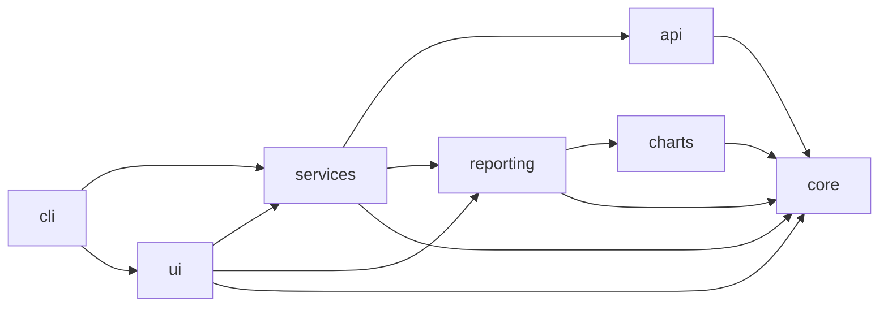
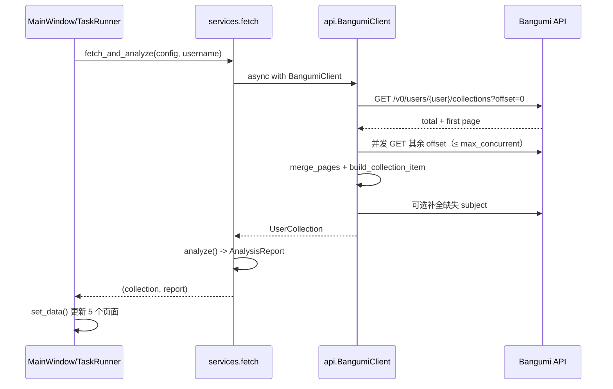

# 架构

## 目标

1. **可预测**：每个目录只做一类事，依赖方向单向，import 图可被机器校验。
2. **可测试**：核心统计与查询不依赖 Qt/网络；网络层可注入 fake transport。
3. **启动快**：桌面启动不加载 Matplotlib；只在真正渲染图表或 HTML 时导入。
4. **可替换**：CLI 与 GUI 共用 `services`，导出/统计只有一份实现。
5. **可 agent 维护**：模块小、命名直白、有执行型文档与测试。

## 分层图



箭头表示允许的 import 方向。`ui`/`cli` 是组合根（composition root），可以依赖
所有内部层；其余层不得反向依赖它们。`tests/architecture/test_layers.py` 用 AST
解析 `src/bangumi_catcher/**/*.py`，违反即测试失败。

## 模块职责

### `core/` — 纯领域

- `models/subject.py`：`Subject`、评分/封面，以及日期派生字段。
- `models/collection.py`：`CollectionItem`、`UserCollection`、完成率语义。
- `models/report.py`：`AnalysisReport` 及图表行模型。
- `config/`：Pydantic 配置、路径发现、YAML/env 合并、校验。
- `analysis.py`：一次遍历产生全部统计；Top N 用 `heapq`。
- `query.py`：表格的搜索文本、显示列、排序键、筛选条件（无 Qt）。
- `errors.py`：`BangumiError` 及子类。

### `api/` — Bangumi 访问

- `client.py`：`httpx.AsyncClient` 生命周期、重试、429/404/4xx/5xx 分流、
  取消检查、单条目缓存。
- `collection.py`：首页取 total → 有界并发取剩余页 → 合并 → 构建条目 →
  补全缺失详情 → 写缓存。
- `pagination.py`：offset 计算与按 offset 合并去重。
- `mapping.py`：兼容 slim / full 两种 subject 形态。
- `cache.py`：diskcache 包装，键含用户名/分类/收藏类型。
- `ratelimit.py`：请求最小间隔。

### `charts/` — 绘图

- `catalog.py`：图表 key 与中文标题，**无 Matplotlib 依赖**，UI 可安全导入。
- `theme.py`：色板、字体探测、Figure 工厂。
- `builders.py`：9 个 `make_*` 构建器，纯函数 `(report, theme) -> Figure`。
- `render.py`：`render_chart` / `render_all`，用进程级 `RLock` 串行化 Agg。

### `reporting/` — 序列化

- `csv_export.py`：CSV 列定义与公式注入防护。
- `json_export.py`：收藏快照与报告 JSON。
- `html.py`：Jinja2 模板 + base64 内嵌 PNG，自包含、可离线打印。
- `atomic.py`：`atomic_output` 上下文管理器（临时文件 + `os.replace`）。

### `services/` — 编排

- `fetch.py`：`fetch_user_collection` / `fetch_and_analyze`，支持注入
  `client_factory`。
- `library.py`：用户名规范化、快照导入（64 MB 上限）。
- `export.py`：格式注册、默认文件名、原子导出、进度回调。
- `cancellation.py`：`threading.Event` → asyncio 取消桥。

### `ui/` — 桌面

```text
app.py             QApplication + 日志 + 错误对话框
main_window.py     外壳、菜单、页面生命周期、TaskRunner
navigation.py      PAGES 定义
sidebar.py         导航栏
fetch_bar.py       同步输入区
overview_page.py   概览
library_page.py    收藏表格 + 筛选
detail_panel.py    作品详情
collection_model.py Qt 模型/代理（规则在 core.query）
chart_page.py      图表页（懒加载 Matplotlib）
report_page.py     排行/年度表
settings_dialog.py 偏好设置
log_dialog.py      日志查看器
workers.py         QThread 任务
theme.py/icons.py  设计令牌与矢量图标
widgets.py         通用小部件
```

### `cli/`

`parser.py` 只负责参数；`main.py` 负责命令分派与退出码；`gui` 命令才懒加载 Qt。
`python -m bangumi_catcher.cli` 与 `bangumi-catcher-cli` 等价。

## 关键数据流

### 在线同步



### 导出

`services.export_dataset` 选择 writer，并把临时路径交给 `reporting.atomic_output`。
HTML 路径会调用 `charts.render_all` 生成 data URI，再渲染 Jinja2 模板。

### 取消

UI 线程设置 `threading.Event` → `run_cancellable` 的 monitor 取消 asyncio task →
httpx 关闭连接 → `OperationCancelled` 传回 UI。窗口关闭时先 cancel 再等待
`QThread.finished`，不会销毁运行中的线程。

## 扩展点

| 想加什么 | 改哪里 | 步骤 |
|---|---|---|
| 图表维度 | `charts/catalog.py` + `builders.py` | [playbook](playbooks/add-chart.md) |
| 导出格式 | `reporting/` + `services/export.py` + CLI/UI | [playbook](playbooks/add-export-format.md) |
| 配置项 | `core/config/models.py` + `config.yaml` + 设置对话框 | [playbook](playbooks/add-config-option.md) |
| 错误类型 | `core/errors.py` + CLI 捕获 | 继承 `BangumiError` |
| UI 页面 | `ui/navigation.py` + 新 page + `main_window` | 页面只依赖 services/core |

## 为什么不用其他结构

- **不做插件系统**：当前没有第三方扩展需求，插件边界会拖慢启动并增加测试面。
- **不引入异步 UI 框架**：Qt 的 signal/slot + 单任务 `TaskRunner` 已足够，
  避免事件循环嵌套。
- **不把图表放进 `ui`**：HTML 导出与 GUI 共用同一渲染器，放在 `charts/` 可被
  CLI 和测试直接使用，并消除 `services -> ui` 的反向依赖（见 ADR-0001）。
- **不使用 `src` 之外的顶层包**：`src/` 布局让“测试通过但安装失败”这类问题
  在 CI 中立即暴露（见 ADR-0002）。

相关决策：[ADR-0001](adr/0001-layered-architecture.md)、
[ADR-0002](adr/0002-src-layout-and-agent-docs.md)、
[ADR-0003](adr/0003-offline-first-testing.md)、
[ADR-0004](adr/0004-charts-and-reporting-split.md)。
